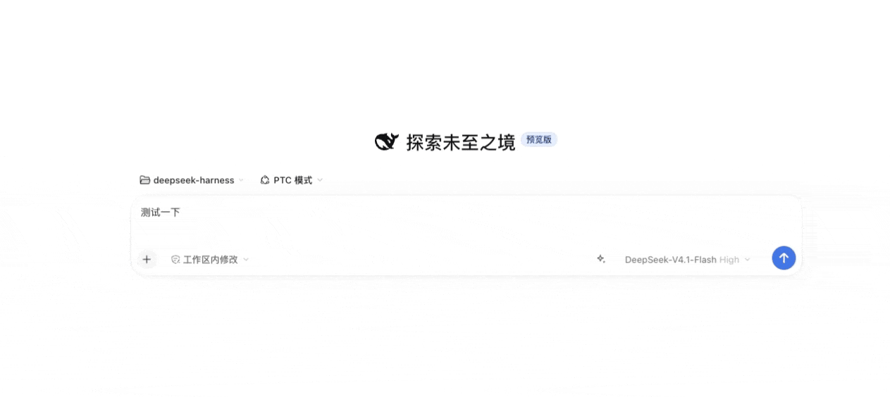

# 提示词优化

输入框工具栏里的一个按钮：把当前草稿改写为更清晰、可执行的提示词，同时纠正错别字、标点、语法、术语和前后矛盾。使用哪条提示词、调用哪个模型，都可以自行设置。



## 使用

- 点击按钮开始优化，完成后草稿被替换，按钮变为「恢复原文」，再点一次还原。
- 优化过程中可以随时取消：再点一次按钮即可中止，不会继续消耗模型额度。
- 优化进行中修改草稿会**自动取消**本次优化——结果建立在修改前的文本上，已经过时；继续消耗额度没有意义。你打的字原样保留。
- 优化失败时按钮变成红色，鼠标悬停可查看原因；修改草稿或重新点击即可清除。
- 草稿被手动修改后，「恢复原文」自动失效，避免覆盖新输入。

### 多会话

每个会话各自持有一份状态，互不干扰：

- 切到别的会话再切回来，按钮仍停在上次的「恢复原文」或失败状态，原草稿也还在。
- 优化进行中切走不会中止请求：结果会写回**发起它的那个会话**，切回去就能看到并恢复；即使是在切回来之后才完成，也会填进输入框。
- 例外：如果切走期间你手动改过那个会话的草稿，完成的结果不会再覆盖它——你的输入优先。
- 在一个会话里取消、失败或恢复，都不会影响其他会话的按钮。
- 例外：整页刷新会重置这些状态（只保留会话自身的草稿）；插件卸载或禁用时会中止所有进行中的请求。
- 为控制内存，最多保留最近 32 个会话的按钮状态，进行中的会话不会被淘汰。

## 设置

打开「设置 → 提示词优化」：

| 字段            | 说明                                                                   |
| --------------- | ---------------------------------------------------------------------- |
| 优化提示词      | 决定草稿如何被改写，每次优化都使用它。                                 |
| 模型            | 默认「跟随当前会话」，即使用输入框当前选择的模型；也可固定为指定模型。 |
| 最大输出 tokens | 单次改写的输出上限，默认 1024，不设上限；设得过大时由模型服务拒绝。    |

模型选择器支持搜索、按服务商分组，方向键上下移动、回车确认。

### 配置文件

设置保存在：

```text
~/.dsh/prompt-tuner/settings.json
```

设置页底部会显示这个路径，点击即可用系统编辑器打开。删除该文件将恢复默认设置。

```json
{
  "prompt": "你是一名提示词工程师兼校对员。……",
  "model": { "provider": "", "model": "" },
  "maxOutputTokens": 1024
}
```

`"provider": ""` 表示跟随当前会话。

打开动作走系统自己的默认应用解析（Windows 上交给 `explorer.exe`，macOS 上强制文本编辑器），因此与双击打开的行为一致；文件尚不存在时会先按默认值生成。

## 自定义提示词时的注意事项

优化结果会直接替换草稿，因此提示词应当要求模型**只输出改写后的正文**，不要附加解释、开场白或代码块标记。否则这些多余内容会一并进入输入框。

## 安装

```bash
dsh plugin --profile <profile> add @kongchenhui/dsh-prompt-tuner
```

（`<profile>` 换成你的 profile 名。）

需要 DeepSeek Harness 0.2.1-rc.5 或更高版本。

## 开发

源码用 TypeScript 编写，构建产物不提交：

```text
src/host/     宿主端：设置文件、模型调用、原生打开器、HTTP 路由
src/client/   浏览器端：输入框控件、设置页、模型选择器（按组件拆分）
tests/        vitest 测试
```

浏览器端的状态分两类：`settings-store.ts` 持有全局一份设置，`tuner-store.ts` 按
`sessionId` 分区持有每个会话的按钮状态与在途请求。harness 在切换会话时会重挂载
`conversation.input.right` 槽，组件局部状态因此必然丢失，需要跨切换存活的东西只能放在后者。
写回目标也由 `tuner-store.ts` 管理：控件挂载时经 `attach` 登记自己的输入框，优化完成时
写进「当时挂载着」的那个输入框——harness 的 `inputActions` 属于随会话切换而销毁重建的
输入壳，捕获发起那一刻的引用会把结果写进已销毁的编辑器。

```bash
npm install        # 安装依赖，并因 prepare 脚本触发一次构建
npm run build      # 构建 lib/index.js、lib/client.js 与 lib/types
npm run typecheck  # tsc 类型检查
npm run lint       # ESLint
npm run format     # Prettier 写入
npm test           # vitest
npm run verify     # 依次执行以上全部
```

浏览器端由 `tsdown` 打包成 harness 的 closure-factory 产物（`window.__ModuleLoader__.load`），样式写在 `.module.css` 里，构建期编译为哈希类名；模块解析只允许 `react` 等平台模块，引入其它 harness 包会在构建期报错。

`locale/*.json` 由 `src/client/locales.ts` 生成，不要手改：

```bash
npm run gen:locale      # 重新生成
npm run verify:locale   # 校验是否过期
```

## 许可证

MIT
